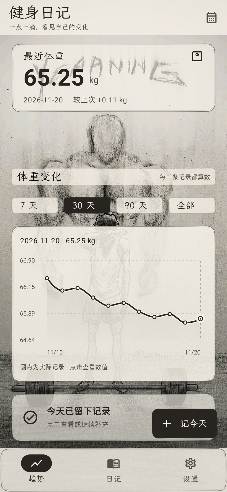
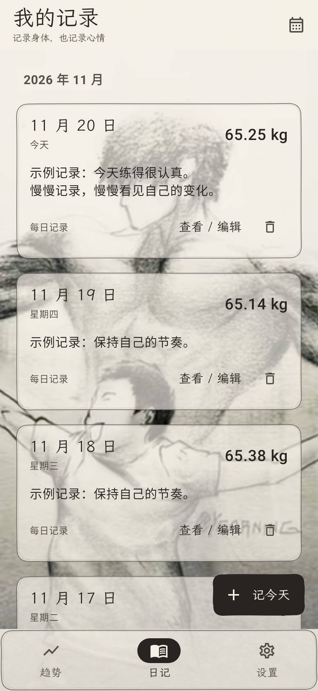
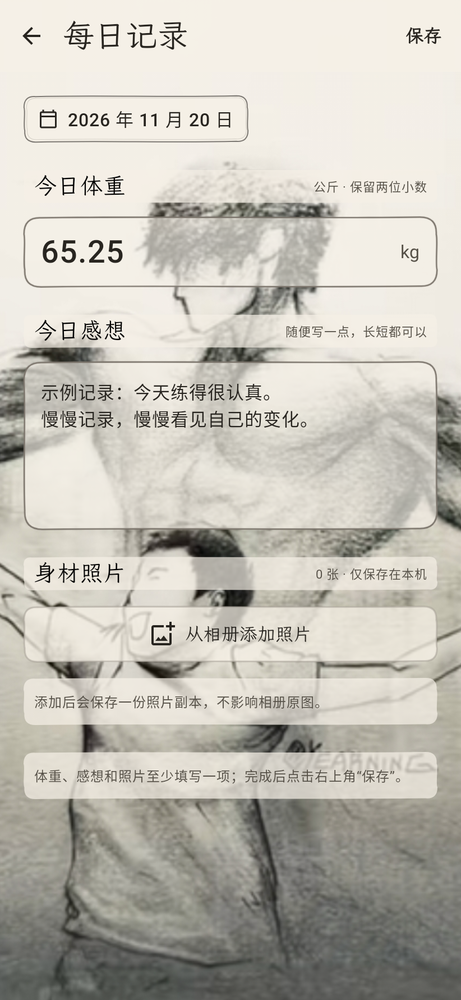
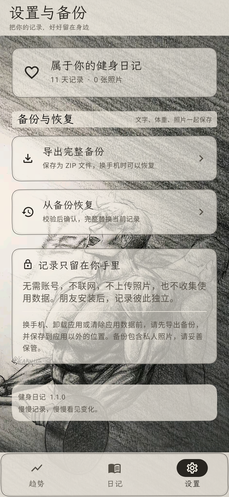

# 健身日记

一个中文、离线运行的 Android 健身记录小工具。记录每日体重、感想与身材照片，用平滑曲线查看变化。无账号、广告、统计或网络权限，数据保存在各自手机中。

当前版本 **1.2.0**，支持 **Android 8.0 及以上**。

## 下载与安装

[**下载最新版APK**](https://github.com/cheems-678/fitness-diary/releases/latest/download/fitness-diary.apk) · [所有版本与校验文件](https://github.com/cheems-678/fitness-diary/releases) · [1.2.0源码ZIP](https://github.com/cheems-678/fitness-diary/releases/download/v1.2.0/fitness-diary-source-1.2.0.zip)

下载 `fitness-diary.apk`，允许对应下载应用安装 APK 后打开。下载入口和JSON接口见 [下载接口](文档/下载接口.md)。源码压缩包不是安装包。

覆盖升级请使用本项目签名的正式 APK，升级前先在设置页导出完整备份。自行编译的 APK 使用不同签名，不能直接覆盖正式版。应用不会自动检查更新。

## 功能

- **手绘开场**：冷启动约3秒，杠铃素描与手写标题渐显，铅笔曲线逐笔画出后淡入趋势页。轻触画面或按返回即可跳过。
- **体重曲线**：公斤单位，精确到两位小数；支持最近7/30/90天及全部记录。横轴按实际日期间隔排列，曲线经过真实记录点、不过冲，点击查看日期与体重。
- **每日感想**：每天一条记录，支持通过日历补记任意过去日期，也可编辑或删除已有记录。体重、文字、照片至少填一项即可保存。
- **身材照片**：系统相册选择，可为每天添加多张，点击查看原色照片、左右翻看。导入后保存私有副本，不修改相册原图。
- **完整备份**：导出包含记录和照片的ZIP，恢复前验证文件完整性；确认后完整替换当前数据。
- **手绘界面**：素描背景、半透明纸片、手写标题与柔和页面切换；曲线使用炭黑实线和纸白衬线，圆点表示实际记录。

## 界面预览

以下是真实Compose界面测试渲染，记录为示例数据，非手机实拍。

| 开场 | 趋势 | 日记 | 编辑 | 设置 |
|---|---|---|---|---|
|  |  |  |  |  |

## 开发

使用JDK17、Android SDK36和仓库自带的Gradle8.13 Wrapper。将项目克隆到英文路径，在Android Studio中打开；详细环境与命令见 [构建说明](文档/构建说明.md)。

```powershell
.\gradlew.bat assembleDebug
```

生成的调试包位于 `app/build/outputs/apk/debug/app-debug.apk`。正式签名密钥不在仓库中。

| 文档 | 内容 |
|---|---|
| [使用说明](文档/使用说明.md) | 补记、编辑、删除、照片及备份恢复 |
| [构建说明](文档/构建说明.md) | 编译、测试、签名与版本 |
| [架构说明](文档/架构说明.md) | 数据模型、照片存储、备份与曲线算法 |
| [下载接口](文档/下载接口.md) | APK固定入口、版本接口及校验 |
| [验证记录](文档/验证记录.md) | 已有构建与测试证据、真机验收范围 |
| [发布说明](文档/发布说明.md) | 发布资源约定、维护流程与1.2.0说明 |
| [第三方素材](文档/第三方素材.md) | 背景原作者、授权范围与字体许可 |

## 许可与反馈

本项目自有代码、文档和自绘矢量图标采用 [MIT](LICENSE) 许可。三张素描背景由**抖音博主 yearning 原创**，维护者已确认获得作者明确授权用于本项目公开仓库与APK；图片不适用MIT许可，其他用途请另行联系原作者。霞鹜文楷使用SIL OFL 1.1，详见 [素材说明](文档/第三方素材.md)。

问题或改进建议请提交GitHub Issue，附应用版本、系统版本、复现步骤；请勿上传私人身材照片、备份ZIP或签名材料。贡献前阅读 [贡献说明](CONTRIBUTING.md)。
